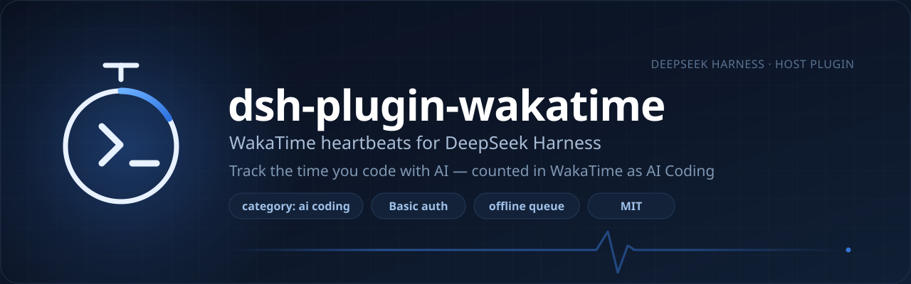

<p align="center">
  
</p>

<p align="center">
  <a href="LICENSE"></a>
  = 20">
  <a href="https://wakatime.com/developers"></a>
  <a href="https://github.com/deepseek-ai/deepseek-harness"></a>
</p>

# dsh-plugin-wakatime

A [DeepSeek Harness](https://github.com/deepseek-ai/deepseek-harness) (DSH) Host plugin that reports the time you spend **coding with AI** inside DSH to WakaTime, as `category: "ai coding"` heartbeats, so it shows up in your **AI Coding** stats next to everything else you track.

It does not fake per-file keystroke heartbeats. It answers one question — was this stretch of time spent working on this project with an AI pair? — and it does so in the background, without blocking the host. Since v0.2 it also ships a **Usage** page inside DSH.

## Features

- **Project-aware** — `entity` is the session's working directory, `project` is its folder name, so AI time is broken down per project in WakaTime.
- **AI-shaped heartbeats** — every beat carries the DSH session id, input/output token deltas, and how many characters you typed.
- **Follows real DSH activity** — user messages, assistant replies, tool calls, and turn boundaries all count; a 15 s keepalive covers long turns, and an idle timeout stops the clock when you walk away.
- **Nothing lost offline** — 429/5xx/network failures land in a local queue (atomic writes, 500 beats max) and are replayed with backoff; a 401 stops sending instead of hammering the API.
- **Built-in Usage page** — a sidebar entry with today / this week / all-time time, a 7-day chart, top projects, token and keystroke counts, plus the WakaTime-side view.
- **Harmless without config** — no `api_key` means one warning in the log and an inert plugin; DSH starts normally.

## Install

The bundle needs its own dependency first: `install_bundle` symlinks a local directory and does **not** install what the bundle depends on.

```bash
git clone git@github.com:Dynesshely/dsh-plugin-wakatime.git
cd dsh-plugin-wakatime
pnpm install          # or npm install
```

Then install the repository root as a bundle from DSH's Plugin Manager:

```text
plugin_manager → install_bundle → D:\Projects\Dynesshely\dsh-plugin-wakatime
```

**Restart DSH** after installing or upgrading — the Host code lives in the server process, so refreshing the page is not enough. Remove it with `remove_bundle` (package name `dsh-plugin-wakatime`).

Prerequisite: an `api_key` under `[settings]` in `~/.wakatime.cfg` — the same file your other WakaTime clients already use. Its `proxy`, `hostname`, and `debug` values are reused.

## Configuration

Config lives on the plugin's row (`config` in `cordis.patch.yml`, or the form in Settings). Precedence: plugin `config` > `~/.wakatime.cfg` > built-in defaults.

| Key | Default | Purpose |
|---|---|---|
| `enabled` | `true` | Master switch. |
| `minIntervalSeconds` | `120` | Minimum gap between heartbeats, all sessions combined. |
| `idleTimeoutMinutes` | `15` | Gap that ends the current timing stretch. |
| `entityType` | `'file'` | `file` reports the project path; `app` reports `DeepSeek Harness`. |
| `includeSubagentSessions` | `false` | Count subagent sessions separately (off: the same wall-clock time is not counted twice). |
| `category` | `'ai coding'` | WakaTime activity category. |
| `apiKey` | empty | Overrides the `api_key` from `~/.wakatime.cfg`. |
| `debug` | `false` | Verbose diagnostics in the log file. |

An empty string means "fall back", not "set it empty". The remaining keys — `apiUrl`, `proxy`, `hostname`, `language`, `userAgent`, `projectFromCwd` — and the exact semantics of all of them are in [docs/design.md](docs/design.md).

## Usage

v0.2 adds a **Usage** page: a sidebar entry sitting next to Plugins, Automation tasks and Context insights. It is fed by the Host route `GET /wakatime/usage.json` (`Cache-Control: no-store`), so everything shown is real data from this machine.

| Block | Shows |
|---|---|
| Local time | today (large), this week, all-time |
| Today's volume | input / output tokens, characters typed, sessions, heartbeats |
| Last 7 days | inline SVG bar chart, one bar per day |
| Projects | top 5 by tracked time |
| WakaTime | whether `api_key` is configured, hostname, today's remote AI Coding time, pending queue size, last send, last error |

Page copy is bilingual and follows DSH's language setting (`en` / `zh`), and the page is drawn with the host's theme variables, so it matches light and dark. The remote figure is derived from your heartbeats (`GET /users/current/heartbeats?date=…`, AI Coding categories only, 60 s cache); if that one request fails, only that block reports an error and the local stats keep working. A refresh button re-fetches the JSON.

## How it works

```text
session/event → accumulate activity + token/char deltas → throttle (≥ minIntervalSeconds)
                                    ├── ok   → WakaTime: single beat, or .bulk (≤ 25 per batch)
                                    └── fail → local queue → backoff replay
```

- Triggers: `user/message`, `assistant/message` (with `usage`), `tool/call`, `tool/result`, `turn/start`, `turn/end`; running turns stay alive thanks to a 15 s tick.
- Auth: `Authorization: Basic base64(api_key)` against the WakaTime API v1. Each beat also feeds a local per-day store (`usage.json`, 30 days) that backs the Usage page.
- Diagnostics: `<DSH_HOME>/cache/wakatime-dsh/wakatime.log` (or `~/.dsh/cache/…` when `DSH_HOME` is unset). The offline queue and state live in the same directory.

## Privacy

Sent to WakaTime: project working-directory path, project name, DSH session id, input/output token counts, characters typed, timestamps, plus `language` and `hostname` when configured.

**Never sent**: code, prompt text, model output, file contents, terminal output. The plugin works on event metadata, never on the text itself. The usage store stays on your disk.

## Development

No build step, plain ESM. `lib/*.js` is testable without DSH:

```bash
pnpm install
node --test
```

```text
index.js            Host entry: Config + apply(ctx, config)
lib/tracker.js      session/event → activity state → heartbeat scheduling
lib/usage.js        per-day aggregation behind the Usage page
lib/client.js       WakaTime HTTP client (auth, batching, retry, proxy fallback)
lib/heartbeat.js    heartbeat builder (pure)
lib/cfg.js          ~/.wakatime.cfg + plugin config merge
lib/queue.js        persistent offline queue (atomic writes)
test/               node:test suites
```

## Docs

- [docs/design.md](docs/design.md) — the implementation contract: settings, events, wire format, v0.2 page.
- [docs/wakatime-api.md](docs/wakatime-api.md) — WakaTime API v1 fields, categories, auth, and retry behavior as measured.
- [docs/harness-api.md](docs/harness-api.md) — DSH plugin API: schema, events, web server routes, slots.

## License

[MIT](LICENSE) © 2026 Dynesshely
